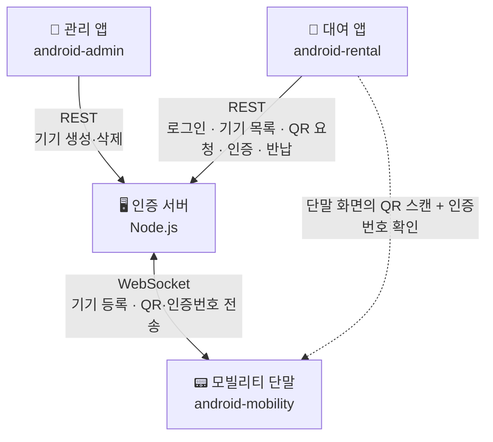
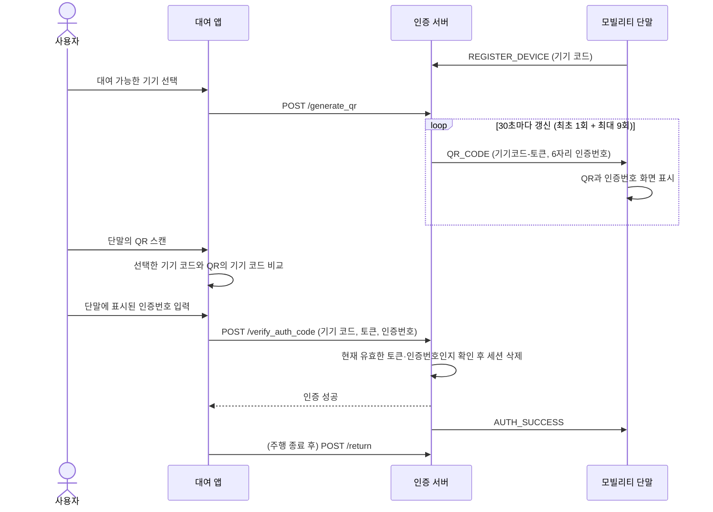

# 🛴 동적 QR 인증 시스템 (Dynamic QR Authentication)

공유 모빌리티의 **정적 QR이 캡처·재사용되는 위험**을 막기 위해, QR을 **30초마다 새로 발급**하고 **기기 화면에만 표시되는 6자리 인증번호**를 함께 확인하는 대여 인증 시스템입니다.

> 🏆 정보보호학과 졸업 프로젝트 · 학술제 본선 장려상

<br>

## 📌 문제 정의

공유 킥보드·자전거에 붙어 있는 QR은 한 번 정해지면 바뀌지 않습니다.
그래서 누군가 QR을 **사진으로 찍어두면 현장에 없어도 대여 요청을 보낼 수 있고**, 다른 QR을 덧붙이는 식의 조작에도 취약합니다.

## 💡 해결 방법

| 위협 | 대응 |
| --- | --- |
| QR을 캡처해 나중에 재사용 | QR 안의 토큰을 **30초마다 새로 발급**해, 지난 QR은 서버에서 거부 |
| 캡처한 QR을 실시간으로 전달 | QR만으로는 대여 불가. **기기 화면에 표시된 6자리 인증번호**까지 입력해야 승인 |
| 다른 기기의 QR을 스캔 | 앱에서 **사용자가 선택한 기기 코드와 QR의 기기 코드가 같은지** 확인 |
| 인증 성공 후 같은 QR 재사용 | 인증에 성공하면 해당 세션을 즉시 삭제해 **한 번만 사용 가능** |

<br>

## 🧩 구성

실제 모빌리티 기기를 구할 수 없어, 기기 역할도 Android 앱으로 대신했습니다.

| 폴더 | 역할 | 기술 |
| --- | --- | --- |
| [`server/`](server) | 인증 서버. 기기 목록 관리, 토큰·인증번호 발급과 검증 | Node.js, Express, ws, bcrypt |
| [`android-rental/`](android-rental) | **사용자 대여 앱**. 로그인 → 기기 선택 → QR 스캔 → 인증번호 입력 → 주행 → 반납 | Kotlin, Retrofit, ZXing |
| [`android-mobility/`](android-mobility) | **가상 모빌리티 단말**. 킥보드에 달린 화면 역할. 서버에서 받은 QR과 인증번호를 표시 | Kotlin, OkHttp WebSocket, ZXing |
| [`android-admin/`](android-admin) | **가상 기기 관리 앱**. 테스트용 모빌리티(기기 코드, 배터리)를 생성·삭제 | Kotlin, Retrofit |
| [`server-simulation/`](server-simulation) | 시연용 서버. 기기가 3대 이상 연결되면 여러 사용자의 대여를 자동으로 재현 | Node.js |

<br>

## 🏗 시스템 구조



## 🔄 대여 인증 흐름



<br>

## ✨ 주요 기능

- **동적 QR 발급**: 대여 요청이 들어온 시점부터 서버가 30초마다 새 토큰과 인증번호를 만들어 WebSocket으로 단말에 전송합니다. 대기 중에는 발급하지 않아 불필요한 부하가 없습니다.
- **2단계 확인**: QR 속 토큰(스캔)과 단말 화면의 6자리 인증번호(입력)가 모두 맞아야 대여됩니다.
- **세션 자동 만료**: 첫 발급 후 30초마다 최대 9번 더 갱신하고, 약 5분이 지나도 인증이 없으면 세션을 종료하고 기기를 다시 대여 가능 상태로 돌립니다.
- **로그인**: 비밀번호는 bcrypt 해시로 저장하고 비교합니다.
- **대여 상태 관리**: 대여 가능 / 대여 중 / 불가(배터리 25% 이하)를 구분해 표시합니다.
- **주행 화면**: 대여 후 이용 시간, 속도, 이동 거리를 시뮬레이션해 보여주고 반납할 수 있습니다.

## 📡 API

| Method | Endpoint | 설명 | 호출하는 곳 |
| --- | --- | --- | --- |
| POST | `/login` | 로그인 (bcrypt 비교) | 대여 앱 |
| GET | `/items` | 기기 목록 조회 | 대여 앱, 관리 앱 |
| POST | `/items` | 가상 기기 생성 | 관리 앱 |
| DELETE | `/items/:id` | 가상 기기 삭제 | 관리 앱 |
| POST | `/generate_qr` | 동적 QR 발급 시작 | 대여 앱 |
| POST | `/stop_qr` | QR 발급 중단 (스캔 취소 시) | 대여 앱 |
| POST | `/verify_auth_code` | 토큰·인증번호 검증 | 대여 앱 |
| POST | `/return` | 반납 | 대여 앱 |
| WS | `REGISTER_DEVICE` → `QR_CODE`, `AUTH_SUCCESS` | 단말 등록과 QR 수신 | 모빌리티 단말 |

<br>

## ▶️ 실행 방법

### 1. 서버

```bash
cd server
npm install

# 로그인 계정 만들기
cp users.example.json users.json
npm run hash-password -- <사용할 비밀번호>   # 출력된 해시를 users.json의 passwordHash에 입력

npm start   # 2454 포트에서 실행
```

### 2. Android 앱 (3개 공통)

1. Android Studio로 각 폴더(`android-rental`, `android-mobility`, `android-admin`)를 엽니다.
2. `network/IpAddress.kt`의 주소를 **서버를 실행한 PC의 IP**로 바꿉니다.
3. `res/xml/network_security_config.xml`의 도메인도 같은 IP로 바꿉니다.
4. 서버와 같은 네트워크에 연결된 기기나 에뮬레이터에서 실행합니다.

### 3. 시연 순서

1. **관리 앱**에서 가상 기기를 생성합니다.
2. **모빌리티 단말 앱**에 생성된 기기 코드를 입력해 서버에 등록합니다.
3. **대여 앱**에서 로그인 후 기기를 선택하고, 단말 화면의 QR을 스캔한 뒤 인증번호를 입력합니다.

<br>

## 🛠 트러블슈팅

### 로컬 서버에 앱이 연결되지 않던 문제

- **상황**: 상시 운영 서버가 없어 노트북을 서버로 띄우고 같은 네트워크의 휴대폰에서 접속했는데, 연결이 거부되거나 노트북의 IP가 바뀔 때마다 앱이 서버를 찾지 못했습니다.
- **원인**: Android 9 이상은 암호화되지 않은 통신(`http://`, `ws://`)을 기본으로 차단합니다. 또 노트북 IP가 바뀔 때마다 앱 코드의 서버 주소를 고쳐야 했습니다.
- **해결**: 서버 주소를 `IpAddress.kt` 한 곳으로 모아 환경이 바뀌면 그 값만 수정하도록 했고, 개발 환경에 한해 `network_security_config.xml`로 해당 IP의 평문 통신을 허용했습니다.
- **배운 점**: 실제 서비스를 만들려면 코드뿐 아니라 네트워크 환경과 플랫폼의 보안 정책까지 이해해야 한다는 것을 알게 됐습니다.

<br>

## 🔐 알려진 한계와 개선 방향

졸업 프로젝트 이후 보안 관점에서 다시 검토하며 정리한 내용입니다.

| 현재 구현 | 문제점 | 개선 방향 |
| --- | --- | --- |
| 토큰·인증번호를 `Math.random()`으로 생성 | 암호학적으로 안전한 난수가 아니라 값이 예측될 수 있음 | Node.js `crypto.randomBytes()` / `crypto.randomInt()` 사용 |
| HTTP·WS 평문 통신 (개발 환경) | 같은 네트워크에서 토큰과 인증번호를 가로챌 수 있음 | TLS를 적용해 HTTPS·WSS로 암호화 |
| 로그인 후 세션·토큰 없음 | 로그인하지 않아도 대여 API를 직접 호출할 수 있음 | 로그인 시 JWT 발급, 모든 API에서 검증 |
| 단말 WebSocket 등록에 인증 없음 | 기기 코드만 알면 다른 단말로 위장 가능 | 단말마다 고유 키를 발급해 등록 시 인증 |
| 인증번호 시도 횟수 제한 없음 | 반복 입력으로 맞힐 수 있음 | 기기·사용자별 실패 횟수 제한과 잠금 |
| `AUTH_SUCCESS`를 모든 연결에 전송 | 다른 단말에도 인증 정보가 전달됨 | 해당 기기의 연결에만 전송 |
| 데이터를 서버 메모리에 저장 | 서버를 재시작하면 기기·세션 정보가 사라짐 | 기기 정보는 DB, 토큰은 Redis에 만료시간(TTL)을 걸어 관리 |
| 실제 하드웨어 없이 앱으로 대체 | 실제 기기 통신 환경과 차이가 있음 | ESP32 + 디스플레이로 단말 구현 |

<br>

## 👤 담당 역할

- 시스템 설계와 개발 전반 (인증 서버, 대여 앱, 모빌리티 단말 앱, 관리 앱, 시뮬레이션 서버)
- 프로젝트 일정 관리와 통합 테스트
